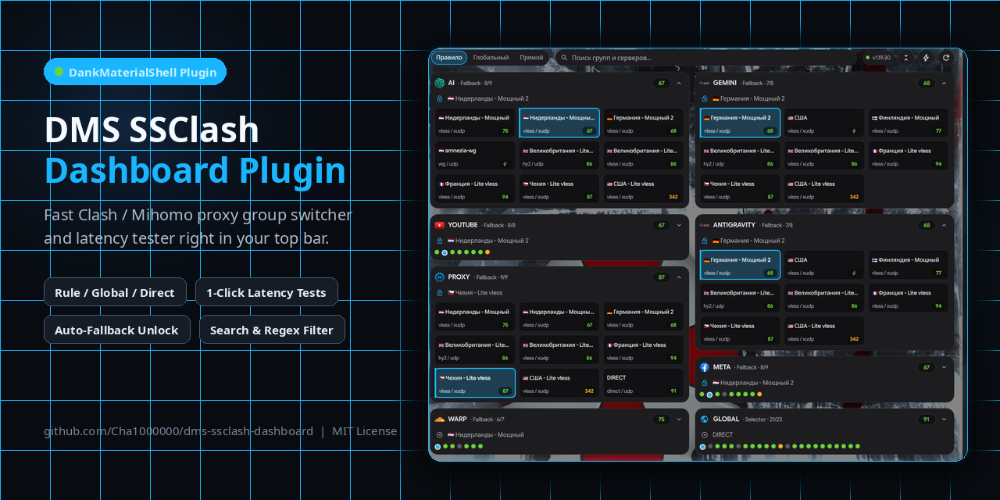
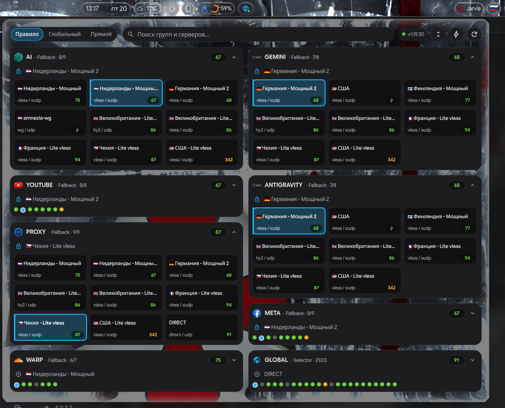

<div align="center">

# DMS SSClash Dashboard Plugin

**A [DankMaterialShell (DMS)](https://github.com/AvengeMedia/DankMaterialShell) bar widget plugin for managing Clash / Mihomo (SSClash) proxy groups directly from your top bar — without opening a browser.**

[](https://github.com/AvengeMedia/DankMaterialShell)
[](https://wiki.metacubex.one/api/)
[](LICENSE)

<br>



</div>

---

## Overview

If you run **SSClash / Mihomo** on your router (e.g. `192.168.10.1:9090`) and usually switch VPN tunnel groups through Zashboard or Metacubexd in a browser tab, this plugin brings that exact dashboard right into your **DankMaterialShell** panel.

- **Compact bar pill**: minimalist globe icon tinted in your accent color with a live router status indicator (green = reachable, yellow = latency test in progress, red = unreachable). Right-click the pill to force an immediate refresh.
- **Native DMS styling**: adapts automatically to your active DMS theme (`surfaceContainer`, `Theme.success/warning/error`) with a configurable neon accent color (default `#19b5ff`).

## Live Screenshot

<div align="center">



</div>

## Features

- **Mode switcher**: instant switching between `Rule`, `Global`, and `Direct` routing modes (`PATCH /configs`).
- **2-column group layout & 3-column server grid**: clear overview of all proxy groups with group icons loaded straight from your Clash config.
- **1-click node switching & auto-fallback unlock**: click any server tile to activate it; for `Fallback` / `URLTest` groups with a locked node (`🔒`), click the lock icon (`DELETE /proxies/{group}`) to return to automatic selection.
- **Latency testing (`⚡`)**: test ping for an individual server, a single group, or all groups simultaneously, with color-coded badges (`< 200 ms` green, `< 450 ms` yellow, `>= 450 ms` red).
- **Live search & regex filtering**: filter proxy groups, active nodes, or server protocols in real time.
- **Collapsible group cards**: collapsed groups show a compact status-dot strip; collapsed states are persisted in DMS plugin settings.
- **IPC support for keybindings**: toggle or refresh the dashboard via `dms ipc`.
- **Zero external dependencies**: uses native QML `XMLHttpRequest` — no `curl` or `jq` scripts required.
- **Localization**: automatic Russian (`ru`) and English (`en`) interface based on system locale.

## Requirements

- [DankMaterialShell](https://github.com/AvengeMedia/DankMaterialShell) `>= 1.2.0`
- A running Clash / Mihomo / SSClash instance with External Controller API enabled (default `http://192.168.10.1:9090`)

## Installation

1. Clone this repository into your DMS plugins directory as `ssclashDashboard`:

```sh
git clone https://github.com/Cha1000000/dms-ssclash-dashboard ~/.config/DankMaterialShell/plugins/ssclashDashboard
```

2. Open **DMS Settings** (`Mod + ,`) → **Plugins**, enable **SSClash Dashboard**, and add it to your bar (`Main Bar`).

## Keybindings / IPC

You can bind a compositor shortcut (e.g. in **Niri** or **Hyprland**) using `dms ipc`:

```sh
dms ipc call ssclash toggle   # Toggle dashboard popout
dms ipc call ssclash open     # Open dashboard popout
dms ipc call ssclash close    # Close dashboard popout
dms ipc call ssclash refresh  # Refresh proxy state from router
```

## Configuration

Available in **DMS Settings** → **Plugins** → **SSClash Dashboard**:

| Setting | Default | Description |
|---|---|---|
| `apiUrl` | `http://192.168.10.1:9090` | Base URL of your router's Clash / Mihomo External Controller |
| `secret` | `""` | Optional Bearer token if your controller has `secret` configured |
| `accentColor` | `#19b5ff` | Neon highlight color for active servers, mode selector, and bar icon |
| `testUrl` | `https://www.google.com/generate_204` | Endpoint used for server latency checks |
| `testTimeout` | `5000` ms | Timeout per latency test (`1000`–`10000` ms) |
| `pollInterval` | `30` s | Background router availability check interval (`10`–`120` s) |
| `showGlobalGroup` | `true` | Show or hide the `GLOBAL` selector card in the dashboard |

## License

[MIT](LICENSE)
